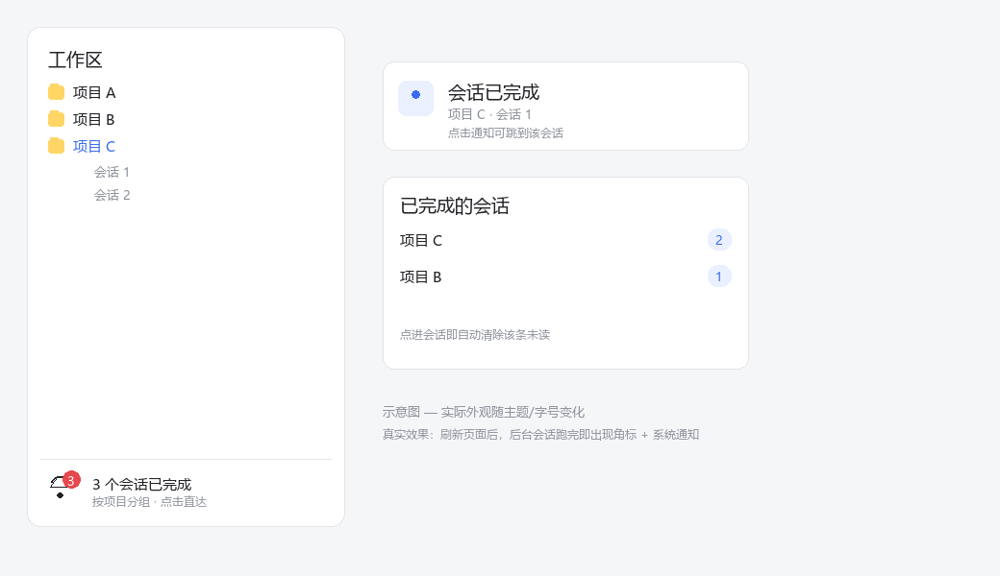

# dsh-session-notify

在多项目工作流下，**被收起项目里跑完的会话不再"悄悄结束"**。

DSH 桌面端/Web 端左侧栏有多个项目（workspace），每个项目下有多个会话。项目收起后，其下仍在运行的会话完成后没有任何提示，必须展开项目、点进会话才能看到"已完成"。本插件补上这个反馈回路：

- **侧边栏底部常驻角标**：按项目分组显示未读完成数（项目收起/展开都可见）
- **系统通知**：每次后台会话跑完发一条 `Notification`（切到别的应用也能收到）
- **点击直达**：点角标 → 列表 → 点会话直接跳转；**点进会话即自动清除**该条未读

## 效果预览



> 示意图：实际外观随主题与字号变化。真实效果为**侧边栏底部角标（按项目分组）+ 系统通知**，点角标可跳转到对应会话。

## 安装

要求：DSH 0.2.x（桌面端或 Web 端 profile 均可）。

```bash
# 方式一：从 GitHub 安装（推荐）
dsh plugin --profile <你的profile名> add github:zach-bworld/dsh-session-notify

# 方式二：本地目录（先 clone 下来）
git clone https://github.com/zach-bworld/dsh-session-notify
dsh plugin --profile <你的profile名> add ./dsh-session-notify
```

安装后**刷新页面或重开窗口**（客户端 bundle 需要重新加载）。Host 侧无需重启。

Agent 用户也可以用 `plugin_manager` 工具安装：`action: install_bundle`，`target` 传该目录绝对路径。

## 工作原理

| 环节 | 使用的 DSH API |
| --- | --- |
| 会话运行状态基线 | `ctx.sessions.list`（`byId[id].running`、`retainedBy.mainView`） |
| 实时状态翻转 | `remote.$on('api-session/status', (sessionId, running) => …)` |
| 项目归属 | `ctx.workspaces.list.items[].sessionIds` |
| 已读清除 | 主视图 retain（`retainedBy.mainView > 0` 即视为正在查看，自动清除） |
| UI 落点 | slot `sidebar.footer.action`（`inject` 提供 `hooks.sessionNotify` / `openSession`） |
| 文案 | client locale 服务（`zh` / `en` 两套字典） |

## 已知限制

1. **无法在"项目行"上打红点**：当前 DSH 侧边栏没有 group-header 级 slot（`sidebar.workspaces` 是单占位，已被上游 WorkspaceBrowser 独占），上游 README 也把"折叠分组不聚合指示"列为已知限制。因此提示落在侧边栏底部。
2. **单独展开项目不会清除提示**：插件拿不到折叠/展开信号；只有点进会话、或该会话重新开始运行才会清除。
3. **系统通知依赖浏览器/Electron 通知权限**，被拒绝时静默降级为仅角标。

## 开发

纯客户端插件（Host 半边 `index.js` 仅 `apply() {}`，用于让 bundle 行激活）。修改 `client.js` 后刷新页面即可看到效果。

## License

MIT
