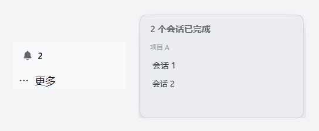

# dsh-session-notify

在多项目工作流下，**被收起项目里跑完的会话不再"悄悄结束"**。

DSH 桌面端/Web 端左侧栏有多个项目（workspace），每个项目下有多个会话。项目收起后，其下仍在运行的会话完成后没有任何提示，必须展开项目、点进会话才能看到"已完成"。本插件补上这个反馈回路：

- **侧边栏底部常驻角标**：按项目分组显示未读完成数（项目收起/展开都可见）
- **系统通知**：每次后台会话跑完发一条 `Notification`（切到别的应用也能收到）
- **点击直达**：点角标 → 列表 → 点会话直接跳转；**点进会话即自动清除**该条未读

## 效果预览



真实截图（项目名与会话名已替换为占位文字）：侧边栏底部的角标显示未读数，点开后按项目分组列出已完成的会话。

## 安装

### 桌面端 App（推荐，普通用户用这个）

1. 打开左侧栏最下方的 **插件**
2. 点 **安装**，粘贴下面这行（这就是安装地址，不是命令）：

   ```
   https://github.com/zach-bworld/dsh-session-notify
   ```

   也接受这几种写法，效果一样：
   - `github:zach-bworld/dsh-session-notify`
   - `git@github.com:zach-bworld/dsh-session-notify.git`
   - 本地目录绝对路径（先 clone 下来）

3. 安装完成后在列表里**启用**它
4. **刷新页面**（Ctrl+R）或重开窗口

> 为什么不用命令行：桌面端的 profile 由 App 独占管理，在 PowerShell 里执行 `dsh plugin --profile desktop add …` 会报
> `profile "desktop" is managed exclusively by the Electron application`。这是设计如此，不是你的问题。

### 命令行 / Web 端

```bash
dsh plugin --profile web add github:zach-bworld/dsh-session-notify
```

`web` 换成你自己的 profile 名即可（常见：`web`、`tui`、`headless`）。
装完刷新页面。

### 装指定版本

```bash
dsh plugin --profile web add github:zach-bworld/dsh-session-notify#v1.0.0
```

### 卸载

在 App 的插件页移除；或命令行：

```bash
dsh plugin --profile web remove @…/dsh-session-notify
```

### 装不上怎么办

| 现象 | 原因 / 处理 |
| --- | --- |
| 命令行报 `managed exclusively` | 桌面端请走 App 内的插件页 |
| 装完没反应 | 客户端 bundle 需要刷新页面才加载 |
| 提示找不到包 | 检查拼写：`github:zach-bworld/dsh-session-notify`（冒号、斜杠都是必需的） |

## 首次使用怎么看效果

1. 在项目 A 里发一个要跑一会儿的任务
2. 立刻切到项目 B
3. 等 A 跑完 → **侧边栏底部出现角标数字 + 一条系统通知**
4. 点角标 → 选会话 → 直接跳过去；点进会话即自动清除

## 工作原理

| 环节 | 使用的 DSH API |
| --- | --- |
| 会话运行状态基线 | `ctx.sessions.list`（`byId[id].running`、`retainedBy.mainView`） |
| 实时状态翻转 | `remote.$on('api-session/status', (sessionId, running) => …)` |
| 项目归属 | `ctx.workspaces.list.items[].sessionIds` |
| 已读清除 | 主视图 retain（`retainedBy.mainView > 0` 即视为正在查看，自动清除） |
| UI 落点 | slot `sidebar.footer.action`（`inject` 提供 `hooks.sessionNotify` / `openSession`） |
| 文案 | client locale 服务（`zh` / `en` 两套字典） |

## 已知限制

1. **无法在"项目行"上打红点**：当前 DSH 侧边栏没有 group-header 级 slot（`sidebar.workspaces` 是单占位，已被上游 WorkspaceBrowser 独占），上游 README 也把"折叠分组不聚合指示"列为已知限制。因此提示落在侧边栏底部。
2. **单独展开项目不会清除提示**：插件拿不到折叠/展开信号；只有点进会话、或该会话重新开始运行才会清除。
3. **系统通知依赖浏览器/Electron 通知权限**，被拒绝时静默降级为仅角标。

## 开发

纯客户端插件（Host 半边 `index.js` 仅 `apply() {}`，用于让 bundle 行激活）。修改 `client.js` 后刷新页面即可看到效果。

## License

MIT
